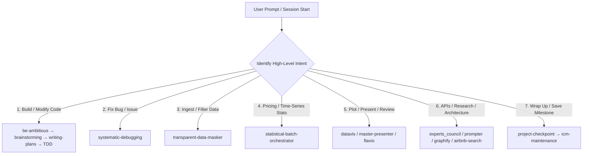

# `skills-route` — Skill Taxonomy & High-Level Intent Router

> **Authority for skill selection & subagent bundling in the Travel Planner repo.**
> Consulted by `skills-orchestrator` at session start, mid-session phase transitions, and when
> dispatching subagents.

---

## 1. High-Level Intent Categories

When an agent receives a prompt, it matches the intent to one of the 7 categories below, determines
the **Active Skill Stack**, and invokes the primary skill before touching files.



---

### Category 1: Feature Creation, Refactoring & Code Modification

- **Trigger:** Adding or changing routing, analytics, database access, ingestion behavior, or any
  non-trivial code path; refactoring; executing a long autonomous run (`/goal`); raising ambition
  (`/be-ambitious`).
- **Skill Stack:** [`be-ambitious`](../be-ambitious/SKILL.md) → [`brainstorming`](../brainstorming/SKILL.md)
  (± [`experts_council`](../experts_council/SKILL.md) for architecture or statistics debates) →
  [`writing-plans`](../writing-plans/SKILL.md) → [`test-driven-development`](../test-driven-development/SKILL.md)
  → [`verification-before-completion`](../verification-before-completion/SKILL.md).
  Autonomous orchestrator: [`goal`](../goal/SKILL.md).
- **Hard Rule:** Red/green TDD is mandatory. Never write implementation code before a failing
  headless test exists and passes headless. Expose every analytical parameter in a signature.

### Category 2: Bug Investigation & Failure Diagnosis

- **Trigger:** Unexpected prices, test failures, regressions, scraper errors, empty DataFrames, or
  crashes.
- **Skill Stack:** [`systematic-debugging`](../systematic-debugging/SKILL.md).
  If the failure is in the agent session itself: [`diagnosing-superpowers`](../diagnosing-superpowers/SKILL.md).
- **Hard Rule:** 4-phase disciplined root-cause tracing. Never apply speculative "fixes" without
  proving the root cause first.

### Category 3: Data Ingestion, Filtering & Masking

- **Trigger:** Dropping flights by stops or travel time, excluding price outliers, masking routes,
  cleaning scraped rows, or changing what enters `/data`.
- **Skill Stack:** [`transparent-data-masker`](../transparent-data-masker/SKILL.md).
  For one-off probes: [`run-experiment`](../run-experiment/SKILL.md).
  For notebook serialization problems: [`jupyter-pickle-rescuer`](../jupyter-pickle-rescuer/SKILL.md).
- **Hard Rule:** Whenever flights or rows are excluded, the code MUST independently track, calculate,
  and log the exact drop count for *each specific criterion* before applying the combined mask.
  The three current criteria are `max_stops`, `max_travel_time`, and any price outlier rule.

### Category 4: Pricing, Time-Series & Population Statistics

- **Trigger:** Moving averages, dip detection, thresholds, route-level aggregation, null models,
  multiple-comparison correction, or scaling a single-route model to a population of routes.
- **Skill Stack:**
  - Cohort scaling, null distributions, FDR: [`statistical-batch-orchestrator`](../statistical-batch-orchestrator/SKILL.md)
  - Safe one-off parameter probes: [`run-experiment`](../run-experiment/SKILL.md)
  - Hardcoded-cutoff audit: [`robustness-audit`](../robustness-audit/SKILL.md)
- **Hard Rule:** Never hardcode `ma_window`, `dip_threshold`, `min_periods`, or a significance
  cutoff. Every statistical reference needs a null built by the same procedure as the observation,
  and multiple-route scans need a multiple-comparisons correction (e.g. Benjamini-Hochberg FDR).

### Category 5: Visualization, Presentation & Peer Review

- **Trigger:** Plotting price history, building route comparisons, generating a report, or auditing
  an analytical claim.
- **Skill Stack:**
  - Standalone figures and publication plots: [`datavis`](../datavis/SKILL.md)
  - Narrative walkthrough decks: [`master-presenter`](../master-presenter/SKILL.md)
  - Metrics-driven technical dashboards: [`scientific-pdf-dashboard`](../scientific-pdf-dashboard/SKILL.md)
  - Hyper-critical naive peer review: [`flavio`](../flavio/SKILL.md)
- **Hard Rule:** Plot percentages where a share is the point, label axes and units, and state the
  sample size. For decks, keep the 260-word limit per page and add "where to look" annotations.

### Category 6: External APIs, Domain Research & Architecture

- **Trigger:** Adding a new flight data source, researching fare behavior, comparing APIs, or
  resolving a domain/architecture question that the code cannot answer.
- **Skill Stack:**
  - Multidisciplinary expert debate: [`experts_council`](../experts_council/SKILL.md)
  - Structured prompts for external research: [`prompter`](../prompter/SKILL.md)
  - Codebase and architecture queries: [`graphify`](../graphify/SKILL.md),
    [`graphify-agentic-extraction`](../graphify-agentic-extraction/SKILL.md)
  - General problem-solving loop: [`fable-method`](../fable-method/SKILL.md),
    [`fable-loop`](../fable-loop/SKILL.md), [`fable-judge`](../fable-judge/SKILL.md)
  - Airbnb shortlist extraction: [`airbnb-search`](../airbnb-search/SKILL.md)
- **Hard Rule:** Cite the source for every external claim. Never invent an API parameter, response
  field, or fare rule. Verify against the provider's documentation before writing the adapter.

### Category 7: Session Wrap-Up, Maintenance & Checkpoint

- **Trigger:** Wrapping up a phase, formatting code, syncing docs, archiving task logs, updating the
  knowledge graph, committing, or pushing.
- **Skill Stack:** [`verification-before-completion`](../verification-before-completion/SKILL.md) →
  [`project-checkpoint`](../project-checkpoint/SKILL.md) → [`icm-maintenance`](../icm-maintenance/SKILL.md).
  Distill reusable lessons with [`lookback`](../lookback/SKILL.md).
- **Hard Rule — Mandatory 6-Step Checkpoint Gate:**
  1. **Headless verification:** run `pytest` with the `travel` interpreter; all tests pass.
  2. **Clean status audit:** `git status` shows no secrets, databases, caches, or scratch files.
  3. **Task archival:** move the completed task file from `planning/tasks/` to
     `planning/tasks/archive/`.
  4. **Audit log:** append the milestone under `# YYYY-MM-DD` in `docs/CHANGELOG.md`.
  5. **Knowledge graph + tree sync:** run `graphify update .`, `serena project index`, and
     `ops/sync_tree.py` (checkpoint/milestone only).
  6. **Explicit staging:** `git add <file>` by path (NEVER `git add .` or `-A`), commit, and push.

---

## 2. Subagent Skill Bundling Protocols

A subagent has no memory of the parent conversation. The parent MUST inject the relevant role
bundle into the subagent prompt.

### Role: Code Implementer (Category 1 & 3)

```markdown
You are an Implementation Subagent. You MUST adhere to:
1. test-driven-development: write a minimal failing test first (RED), run it, implement (GREEN), refactor.
2. transparent-data-masker (if filtering flights): log the exact drop count per criterion.
3. AGENTS.md NEVER rules: no hardcoded thresholds, no untested math, expose all parameters.
Verify the full test suite passes before completing.
```

### Role: Code Reviewer (Category 1, 2 & 4)

```markdown
You are a Code Reviewer Subagent. You MUST adhere to:
1. requesting-code-review / receiving-code-review.
2. robustness-audit: verify headless tests exist, no hardcoded analytical parameters, single-declaration imports.
Deliver an evidence-based review with specific line citations.
```

### Role: Quant / Pricing Reviewer (Category 4)

```markdown
You are a Pricing Analytics Reviewer. You MUST adhere to:
1. statistical-batch-orchestrator: check null construction, multiple-comparison correction, and aggregation level.
2. robustness-audit: challenge every window, threshold, and cutoff.
Demand the raw per-route distribution behind any aggregate claim.
```

### Role: Research / Architecture Specialist (Category 6)

```markdown
You are a Research Subagent. You MUST adhere to:
1. experts_council or prompter: state assumptions, cite sources, and separate evidence from inference.
2. graphify: query the local knowledge graph before reading raw files.
```

### Role: Documentation / Maintenance (Category 7)

```markdown
You are a Documentation Synchronizer Subagent. You MUST adhere to:
1. icm-maintenance: run ruff, then `python ops/sync_tree.py`.
2. Standardized CONTEXT.md: keep the 6-part room contract current.
3. project-checkpoint: archive the task log and append the changelog.
```

---

## 3. Full Skill Classification

Every installed skill is assigned to at least one category. No orphan skills.

| Skill | Categories | Primary use |
|---|---|---|
| `skills-orchestrator` | 1–7 | Mandatory session-start routing and subagent packaging |
| `skills-route` | 1–7 | This taxonomy; selection authority |
| `project-checkpoint` | 7 | Phase wrap-up, changelog, git |
| `icm-maintenance` | 7 | ruff, tree sync, interpretability checks |
| `strict-agent-pipeline` | 1, 7 | Enforces the 9-step pipeline |
| `verification-before-completion` | 1, 7 | Evidence before success claims |
| `goal` | 1 | Autonomous long-running execution |
| `lookback` | 7 | Distill a session into a reusable skill |
| `icm-init` | 7 | Scaffold or extend ICM architecture |
| `be-ambitious` | 1 | Raise altitude, depth, and range |
| `brainstorming` | 1 | Requirements and design before creative work |
| `writing-plans` | 1 | Dependency-ordered implementation plans |
| `executing-plans` | 1 | Inline plan execution with gates |
| `test-driven-development` | 1, 4 | Red/green/refactor |
| `systematic-debugging` | 2 | Root-cause investigation |
| `subagent-driven-development` | 1 | Subagent-per-task execution |
| `dispatching-parallel-agents` | 1 | Independent parallel work |
| `requesting-code-review` | 1, 2 | Request a review package |
| `receiving-code-review` | 1, 2 | Evaluate review feedback rigorously |
| `finishing-a-development-branch` | 1, 7 | Integration decision after tests pass |
| `using-git-worktrees` | 1 | Isolated feature workspaces |
| `writing-skills` | 7 | Create and test new skills |
| `robustness-audit` | 1, 4, 7 | Test existence and hardcoded-parameter audit |
| `diagnosing-superpowers` | 2, 7 | Diagnose a failed agent session |
| `module-migrator` | 1 | Move code into a modular folder safely |
| `transparent-data-masker` | 3 | Per-criterion drop counts |
| `statistical-batch-orchestrator` | 4 | Cohort scaling, nulls, FDR |
| `jupyter-pickle-rescuer` | 3, 4 | Load notebook-pickled objects |
| `run-experiment` | 1, 4 | Safe one-off parameter probes |
| `datavis` | 5 | Figures and charts |
| `master-presenter` | 5 | Narrative PDF walkthroughs |
| `flavio` | 5 | Hyper-critical page-by-page review |
| `scientific-pdf-dashboard` | 5 | Metrics-driven PDF dashboards |
| `experts_council` | 1, 6 | Multi-expert debate and verdict |
| `fable-method` | 1, 6 | General problem-solving loop |
| `fable-loop` | 1, 6 | Orchestrated evidence-and-verdict loop |
| `fable-judge` | 1, 7 | Adversarial verification of "done" |
| `fable-domain` | 1, 6 | Build a domain skill bundle |
| `prompter` | 6 | Structured research prompt for external experts |
| `graphify` | 6 | Query the knowledge graph |
| `graphify-agentic-extraction` | 6 | Background semantic graph extraction |
| `airbnb-search` | 3, 6 | Airbnb search URL → filtered CSV + Markdown shortlist |

---

## 4. Travel-Specific Routing Overrides

| Task | Category | Required skills |
|---|---|---|
| Add a new flight API or data source | 1 + 3 + 6 | `brainstorming`, `writing-plans`, `test-driven-development`, `transparent-data-masker`, `experts_council` |
| Change moving average or dip detection | 1 + 4 | `test-driven-development`, `statistical-batch-orchestrator`, `robustness-audit` |
| Change scraper filters or rate limiting | 1 + 3 | `test-driven-development`, `transparent-data-masker` |
| Change the SQLite schema or path | 1 + 3 | `test-driven-development`, `transparent-data-masker`, `db_manager` authority |
| Explore prices in the notebook | 5 | `datavis` |
| Search Airbnb and build a shortlist | 3 + 6 | `airbnb-search`, `transparent-data-masker`, `verification-before-completion` |
| Write or update a spec | 1 | `writing-plans`, `strict-agent-pipeline` |
| Wrap up a phase | 7 | `verification-before-completion`, `project-checkpoint`, `icm-maintenance` |

---

## 5. Golden Rule for Adding a New Skill

Whenever a new skill is created in `.agents/skills/`:

1. It MUST be placed in `.agents/skills/<skill-name>/SKILL.md`.
2. It MUST be catalogued in [`docs/CUSTOM_SKILLS.md`](../../../docs/CUSTOM_SKILLS.md).
3. **MANDATORY:** It MUST be assigned to one of the 7 categories above in this file.
4. If bound to a specific folder, it must be added to the `AGENTS.md` Routing table.
